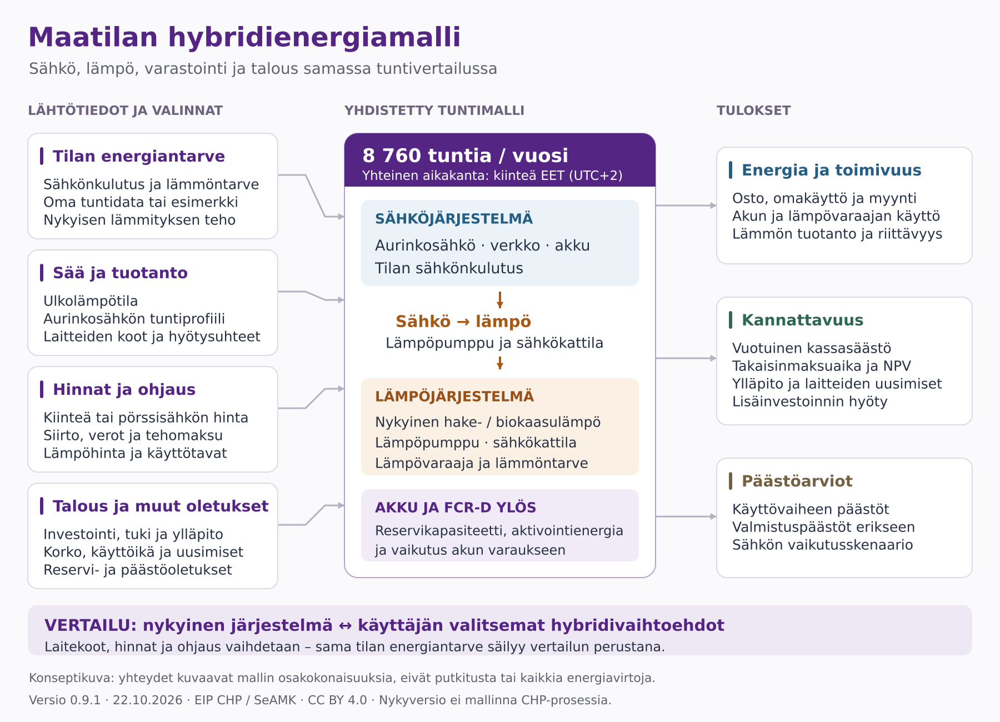

# Mitä hybridienergiamalli yhdistää?

Osakokonaisuuksien omat käsitekartat:

- [Tilan energiantarve](kuvat/Tilan_energiantarve_kasitekartta.png): sähkönkulutus, lämmöntarve, lähtötiedon valinta ja yhteinen aikakanta. [SVG-versio](kuvat/Tilan_energiantarve_kasitekartta.svg).
- [Sää ja tuotanto](kuvat/Saa_ja_tuotanto_kasitekartta.png): ulkolämpötila, PV-tuottoprofiili, laiteominaisuudet ja tuotannon kohdistaminen tarpeeseen. [SVG-versio](kuvat/Saa_ja_tuotanto_kasitekartta.svg).
- [Hinnat ja ohjaus](kuvat/Hinnat_ja_ohjaus_kasitekartta.png): sähkön ja lämmön hinnat sekä akun, lämpöpumpun, sähkökattilan ja reservin käyttötavat. [SVG-versio](kuvat/Hinnat_ja_ohjaus_kasitekartta.svg).
- [Talous ja muut oletukset](kuvat/Talous_ja_muut_oletukset_kasitekartta.png): investointi, tuki, vuosikassavirta, tarkasteluaika, uusimiset sekä reservi- ja päästöoletukset. [SVG-versio](kuvat/Talous_ja_muut_oletukset_kasitekartta.svg).

Malli yhdistää tilan sähkönkulutuksen ja lämmöntarpeen, sää- ja tuotantoprofiilit, laitteet, hinnat ja käyttötavat sekä investointioletukset. Kaikki energiataseet lasketaan samassa 8 760 tunnin aikakannassa. Lämpöpumppu ja sähkökattila kytkevät sähköjärjestelmän lämmitykseen. Akku ja lämpövaraaja siirtävät energian käyttöä ajassa. Akun reservikäyttö vaikuttaa energiatasapainoon ja tuottoon.

Tuloksina esitetään energian käyttö ja riittävyys, taloudellinen vertailu sekä erilliset päästöarviot. Kuva on käsitteellinen: yhteydet eivät kuvaa yksittäisiä sähköjohtoja, putkia tai kaikkia sallittuja energiavirtoja. Tarkat ohjaus- ja laiterajaukset ovat [menetelmäkuvauksessa](MENETELMA.md). Nykyversio ei mallinna CHP-laitosta tai biokaasun tuotantoprosessia.

- [SVG-vektorikuva](kuvat/hybridienergiamalli-konseptikuva.svg): skaalautuu ja on muokattavissa vektorigrafiikkaohjelmassa.
- [PNG-kuva](kuvat/hybridienergiamalli-konseptikuva.png): sopii esityksiin ja tekstiasiakirjoihin.

Kuvan pohjana on laskurin version 0.9.1 menetelmäkuvaus. Versiossa 0.9.2 lisätyt CHP-sähkö ja kokoonpanon optimointi eivät vielä näy kuvissa; ks. [MENETELMA.md](MENETELMA.md). Päiväys 22.10.2026. Tekijäviite: Maatilan hybridienergialaskuri, EIP CHP Energiaälykäs eteläpohjalainen maatila -hanke / SeAMK. Lisenssi [CC BY 4.0](../LICENSE).
